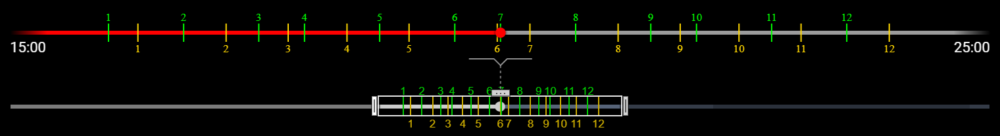
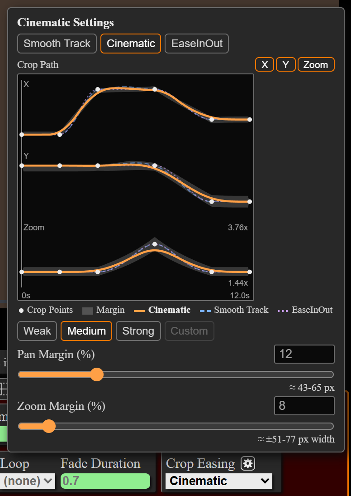
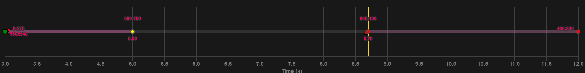
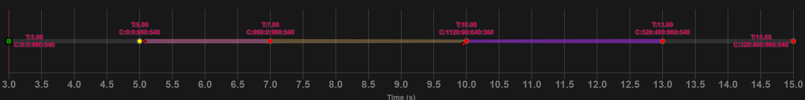

# Changelog

All notable changes to this project will be documented in this file. See [commit-and-tag-version](https://github.com/absolute-version/commit-and-tag-version) for commit guidelines.

## [5.50.0](https://github.com/exwm/yt_clipper/compare/v5.49.0...v5.50.0) (2026-11-07)

5.50.0 adds a timeline zoom for crowded markers and steadier video stabilization.

### Highlights

#### Timeline Zoom

Press **Shift+F**, or click its button (three dots over a two-way arrow) in the settings editor toolbar, to toggle the timeline zoom. Use it when marker pairs crowd together on long videos.

* A **zoomed bar** above the progress bar magnifies the zoom range, so nearby pairs spread out.
* On the progress bar, the **brush** frames the zoom range and shades the rest. **Drag** its edge handles to resize the zoom range, and its center handle to move it.
* On the zoomed bar, marker pairs work as on the progress bar. **Click** a marker number to open its pair, and **Alt+Drag** a number to move its marker. **Scroll** to zoom in or out, and **Shift+Scroll** to pan.
* During playback the zoom range follows the playhead.
* **Flatten VR Video** moved from **Shift+F** to **Shift+T**.
* See [this readme section](https://github.com/exwm/yt_clipper#marker-navigation-shortcuts) for the full details.

#### Video Stabilization

* Presets weaker than **Strongest** crop more and steady more than in 5.49.0.
* The motion analysis follows the camera instead of things that move on their own, and repairs the motion at flashes. Turn it off with `--no-video-stabilization-motion-analysis` (`-nvsma`) if a clip jolts or drifts.
* The `clipper script` warns when a stabilized clip comes out shakier than its input.
* The unstabilized clip is saved only with `--video-stabilization-save-shaky-clip`.
* For jumps between crop points, use **Cinematic** crop easing instead.
* See [this readme section](https://github.com/exwm/yt_clipper#video-stabilization) for the full details.

### ⚠ BREAKING CHANGES

* **markup:** move Flatten VR Video to `shift+t`, freeing `shift+f` for the timeline zoom
* **clipper:** presets weaker than Strongest crop more than 5.49.0 did (median Very Weak about 0.7% -> 4.3%, Medium about 2.1% -> 9.1%), with about half the shake
* **clipper:** the unstabilized clip in `clips/shaky` is not saved by default anymore -> pass `--video-stabilization-save-shaky-clip` to keep it

### Features

* **clipper:** add `--no-video-stabilization-motion-analysis` (`-nvsma`) to turn off the motion analysis, which repairs the motion at flashes and ignores things that move on their own ([6494379](https://github.com/exwm/yt_clipper/commit/649437926a8c4af09b7283a9a04bdc4172c7e3d2))
* **clipper:** clips made for an AV1 merge of different sizes are encoded at the merge's size (every codec with `--merge-rescale always`), with the merge plan logged before encoding ([a139c8f](https://github.com/exwm/yt_clipper/commit/a139c8f88eb290b14c06be9689d9abe4b89de129))
* **clipper:** deprecate `--video-stabilization-dynamic-zoom`/`-vsdz`, which now has no effect and warns ([a110ee9](https://github.com/exwm/yt_clipper/commit/a110ee9771fdbdd711ea8364e56f50d0e56a65a7))
* **clipper:** save the unstabilized clip only with `--video-stabilization-save-shaky-clip`, since making it doubled the time stabilization takes ([f36d252](https://github.com/exwm/yt_clipper/commit/f36d252961fc5226d019e54b2fbc80633e6068a7))
* **clipper:** video stabilization sizes its zoom to each clip's shake, so presets weaker than Strongest crop more and steady more than in 5.49 ([d116d21](https://github.com/exwm/yt_clipper/commit/d116d21d87ab4c15ba1254eb3a36e50c0fb2adcb))
* **markup:** add a settings editor toolbar button to toggle the timeline zoom ([31860ed](https://github.com/exwm/yt_clipper/commit/31860eda618a7c715eb6fa7d5ce981d8728ee9bb))
* **markup:** add a timeline zoom (`shift+f`), a zoomed copy of the progress bar above it, so crowded markers on long videos spread out ([4d32eff](https://github.com/exwm/yt_clipper/commit/4d32eff0413b2486f95b1fa1e506e1db5c8675cd))
* **markup:** command palette: show a subtitle under each shortcut and long shortcut descriptions in a tooltip ([51ead09](https://github.com/exwm/yt_clipper/commit/51ead092b6d54c6ba402d80265a9ec2917ce436b))
* **markup:** move Flatten VR Video to `shift+t`, freeing `shift+f` for the timeline zoom ([791e2a2](https://github.com/exwm/yt_clipper/commit/791e2a20aa7232aaeeed7bb6500e347969cf2461))
* **markup:** remove the Dynamic Zoom stabilization setting, which has no effect with the bundled ffmpeg ([d8adb79](https://github.com/exwm/yt_clipper/commit/d8adb79b8fac43d85cf268d133e43daea0e16e38))
* **markup:** show milliseconds next to the player's current time on YouTube and local videos ([c0813fe](https://github.com/exwm/yt_clipper/commit/c0813fe7f2652dd7bf86f14005ff7562b312ddfb))

### Bug Fixes

* **clipper:** an instant crop point should switch on the frame the preview shows, even when the start marker is partway into a frame ([412b6f9](https://github.com/exwm/yt_clipper/commit/412b6f96272e797ba9ca86fe6dee288441069282))
* **clipper:** clips made with video2x should keep the source's frame timing, so variable frame rate sources interpolate smoothly ([c665452](https://github.com/exwm/yt_clipper/commit/c665452eeaa3f5a2dc7b0d55fb014c30ae4a1a8c))
* **clipper:** denoise should use the preset the markers JSON names, ignoring its saved strength, so presets can change between releases ([ae11414](https://github.com/exwm/yt_clipper/commit/ae1141416e95d1f8918833b061e800d3fa26c4c7))
* **clipper:** merges of av1 clips of different sizes should play correctly with hardware decoding, by rescaling the clips to one size (`--merge-rescale`) ([c4f436e](https://github.com/exwm/yt_clipper/commit/c4f436eb838d9cb66fa49371d67627eed19c9b62))
* **clipper:** motion interpolation should keep the clip's length and timing when duplicate frames are not removed, including for variable frame rate sources ([0804155](https://github.com/exwm/yt_clipper/commit/08041550a212ffb52ff21e9ea8466dd29dcc8331))
* **clipper:** skip a merge of clips with different codecs, which ffmpeg writes with only the first codec playable ([ace342d](https://github.com/exwm/yt_clipper/commit/ace342d56ec872d8a771c256191b7939496ba360))
* **clipper:** stabilization should use the preset the markers JSON names, ignoring its saved preset numbers, so presets can change between releases ([1e5de2c](https://github.com/exwm/yt_clipper/commit/1e5de2c81acfdffc7a677096f03405c7f506ca7d))
* **clipper:** stop before clipping with a clear message when ffmpeg lacks the `--video-codec` encoder, such as AV1 in the macOS release ([f46a349](https://github.com/exwm/yt_clipper/commit/f46a34902d34b252c70317b50bb82bc505d285d7))
* **clipper:** video stabilization should follow the camera instead of a subject moving on its own or the wrong tile of a tiled wall, also in slowed-down clips + warn when it makes the clip shakier than its input ([58c521c](https://github.com/exwm/yt_clipper/commit/58c521cbcb32acc2d44be46aab636fdce3719218))
* **clipper:** video stabilization should keep tracking dim and stage-lit scenes, and should not shake at flashes or stage lights ([af7f7d7](https://github.com/exwm/yt_clipper/commit/af7f7d7327c004986e11a773444941162da0ff68))
* **markup:** a crop or speed point added at the playhead should keep its exact time instead of rounding to 0.01 s, which could move it to a neighboring frame ([511a7da](https://github.com/exwm/yt_clipper/commit/511a7da0923b70bcdef1e0aae28c161dc392fa66))
* **markup:** clicking the progress bar outside a looping marker pair should jump to the loop start without flashing the clicked frame ([987d926](https://github.com/exwm/yt_clipper/commit/987d9268b9ead6b8077c5522f613d23390036cf1))
* **markup:** flash messages should stay readable on light pages, such as YouTube's light theme ([a51a05a](https://github.com/exwm/yt_clipper/commit/a51a05a1765688dc117c3241974c25d61e512a5f))
* **markup:** generic site: flash messages should show below the marker pair editor, as on YouTube ([189a617](https://github.com/exwm/yt_clipper/commit/189a61703dc52754c362357c505391d11f65f702))
* **markup:** marker numbers and the timeline zoom's times should stay readable over bright or matching video colors ([2631443](https://github.com/exwm/yt_clipper/commit/263144305c94926a30d62fda7ac83ae421bc8ba6))
* **markup:** settings inputs should not flash the invalid color each time an editor opens ([23741e8](https://github.com/exwm/yt_clipper/commit/23741e855e25283f0cd3546a0143e1536bb0ec6d))
* **markup:** show the crop aspect ratio rounded, such as 1.778 (16:9), instead of to 13 decimals ([d4f7ddd](https://github.com/exwm/yt_clipper/commit/d4f7dddcb408fc318974526c8e9b77a6df0cfd11))
* **markup:** the crop easing settings should use a dark dropdown like the other fields, and the crop path plot should fill the panel's width ([ee7455e](https://github.com/exwm/yt_clipper/commit/ee7455e75cc708dc6aca1d9da2a8d4fb4a1c0519))
* **markup:** the crop rectangle's dashed border should read over any video, with a thin dark line outside it that leaves the cropped video untouched ([8af479f](https://github.com/exwm/yt_clipper/commit/8af479fd540570e1f2b120432a9a9204fcfb077d))
* **markup:** the marker pair editor's title row should stay on one line instead of wrapping the Next button below Prev ([9fc2234](https://github.com/exwm/yt_clipper/commit/9fc2234a8a178714c690bd3b39c7f9e3c9c58c94))

### Major Dependency Upgrades

* **clipper:** update to ffmpeg 9.0.2 and video2x 6.6.0, which exits cleanly after interpolating ([c1bdd7b](https://github.com/exwm/yt_clipper/commit/c1bdd7bd14e199201cff3e2c9ce9899ef535e464))

### Documentation Updates

* **readme:** add a Video Stabilization section that gathers the stabilization notes, with Cinematic crop easing for jumps between crop points ([0d82eb4](https://github.com/exwm/yt_clipper/commit/0d82eb409adb56145549e411c9ad5242d468ca30))
* **readme:** describe how merges of av1 marker pairs of different sizes are scaled to one size, and `--merge-rescale` ([71e7516](https://github.com/exwm/yt_clipper/commit/71e751684445651a4c18e9003cd1c791bbc7ab4e))
* **readme:** note that weaker stabilization presets crop and steady more since 5.50.0 ([756930d](https://github.com/exwm/yt_clipper/commit/756930d472e17863bff37ae84be427bb320de114))
* **readme:** note which ffmpeg version to use and how video stabilization differs with older ones ([ebebd40](https://github.com/exwm/yt_clipper/commit/ebebd40aa7073d8f91775e63ba08596bd381f6d8))
* **readme:** point the manual video2x install at the yt_clipper build of video2x 6.6.0, since upstream video2x lacks an option the clipper uses ([51a60d4](https://github.com/exwm/yt_clipper/commit/51a60d48952f5d106acc5345a23a786554b03376))
* **readme:** say that the macOS release's ffmpeg can't encode AV1 ([6ec4e74](https://github.com/exwm/yt_clipper/commit/6ec4e74c20e551bad9549aa68d112c3824f4728c))

## [5.49.0](https://github.com/exwm/yt_clipper/compare/v5.48.0...v5.49.0) (2026-11-01)

### Highlights

#### Crop Easing

Use the **Crop Easing** setting to choose how a dynamic crop pans and zooms between crop points. Find it in the global settings editor, and override it per marker pair in the marker pair editor.

* **Smooth Track (default):** The crop keeps moving through points without stopping at each one. Use it to follow a moving subject.
* **Cinematic:** The crop follows the points within a margin, with steady pauses and constant-speed pans. Use it for camera-like motion.
  * Click the gear button next to **Crop Easing** to set the margins, or pick **Weak**, **Medium** or **Strong**.
  * In a marker pair's settings, a plot shows the Cinematic path next to the Smooth Track and EaseInOut paths.
* **EaseInOut:** The crop easing from before 5.49.0. The crop slows to a stop at every point. The `markup script` and the `clipper script` use EaseInOut for markers data saved before 5.49.0.
* See [this readme section](https://github.com/exwm/yt_clipper#crop-easing) for the full details.

#### Hold Points

A hold point shows the crop of the crop point before it, and follows when that point changes. Hold points have a vertical yellow bar behind them. A new marker pair ends in a hold point.

* **Ctrl+Shift+Click:** Toggle a crop point between hold and normal.
* **Ctrl+Alt+A:** Add a hold point at the current time, or toggle the crop point under the playhead.
* **Ctrl+Alt+Shift+Click:** Toggle crop point easing between auto and instant (moved from **Ctrl+Shift+Click**).
* With Cinematic crop easing, the crop slows down evenly into each hold and holds still there. Set **Hold Points** to **Firm** in the Crop Easing settings to stop within the **Pan Margin**.
* See [this readme section](https://github.com/exwm/yt_clipper#crop-chart-shortcuts) for the full details.

#### Update Checks and Shared Settings

* Run `yt_clipper_check_for_updates.bat` (Windows) or `yt_clipper_check_for_updates` (Mac), or pass `--check-for-updates`, to check for a newer `clipper script`.
* Put settings every version should use (for example `--cookies`) in `yt_clipper_default_args.txt` in the folder that holds your yt_clipper installs. An install's own `default_args.txt` overrides the shared file when both set the same option.
  * Keep your installs in a folder of their own, not in your downloads folder. A `yt_clipper_default_args.txt` saved next to them can set the folders the `clipper script` runs ffmpeg and yt-dlp from.
  * Put options new in 5.49, such as `--accept-lower-quality`, in the install's own `default_args.txt`. Older versions stop on an option they do not know.
* Click **Releases** at the bottom right of the command palette (**Shift+E**) to see what changed.
* See [this readme section](https://github.com/exwm/yt_clipper#updating) for the full details.

### ⚠ BREAKING CHANGES

* **markup:** **Ctrl+Shift+Click** on a crop point now toggles hold instead of instant easing. Instant easing moved to **Ctrl+Alt+Shift+Click**.
* **clipper:** an install's own `default_args.txt` now overrides the shared `yt_clipper_default_args.txt` when both set the same option.
* **clipper:** the `clipper script` no longer accepts shortened option names, such as `--overwr` for `--overwrite`. Use the full name.
* **clipper:** the `clipper script` now reads its install's `default_args.txt` when run from another folder. It reads `yt_clipper_default_args.txt` from the folder that holds the installs, not from the folder above the one you run it in. Move that file there if you keep it elsewhere.
* **clipper:** when only a lower quality format can be downloaded and the prompt gets no answer (a scheduled run, or stdin closed), the run now stops with exit code 1 instead of clipping at the lower quality. Pass `--accept-lower-quality` to keep clipping at the lower quality.

### Features

* **clipper+markup:** add Cinematic crop easing: the crop follows crop points within a margin, with steady pauses and constant-speed pans ([f96981e](https://github.com/exwm/yt_clipper/commit/f96981eb152e5e4775fdb278415b6354080c2137))
* **clipper+markup:** add the `Hold Points` setting (Loose, Firm or Exact) to the Crop Easing settings to choose how still Cinematic crop easing holds the crop at hold points ([4bee2e4](https://github.com/exwm/yt_clipper/commit/4bee2e43d3c298c06e4f60c2d96c0d887046e5d1))
* **clipper+markup:** add the Crop Easing setting: in its default Smooth Track mode, a dynamic crop keeps moving through crop points instead of stopping at each one ([4473bd7](https://github.com/exwm/yt_clipper/commit/4473bd74ac62284f47481774fb2d9da274533a91))
* **clipper+markup:** hold crop points, which show the crop of the crop point before them and follow it when it changes + a new marker pair's end point is a hold point ([ba4b128](https://github.com/exwm/yt_clipper/commit/ba4b128d325f7e4ce19087d503e1f93c3a703db6))
* **clipper+markup:** Weak, Medium and Strong presets for the Cinematic margins, which scale with the crop size ([4c0e686](https://github.com/exwm/yt_clipper/commit/4c0e6860185c209fea902923ca4847cf6f0e195e))
* **clipper:** ask before continuing with a lower quality format when a higher quality one cannot be downloaded (`--accept-lower-quality` continues without asking) + show the selected formats in green and those that cannot be downloaded in red + clip only the video, not its playlist, from a video URL with `&list=` ([a2e0469](https://github.com/exwm/yt_clipper/commit/a2e0469b5b84f5daac915cc843e661bf54980e34))
* **clipper:** check for a newer `clipper script` with `--check-for-updates` or the `yt_clipper_check_for_updates` helper + keep settings across versions in `yt_clipper_default_args.txt` + warn when a markers JSON comes from a newer `markup script` ([da408c1](https://github.com/exwm/yt_clipper/commit/da408c1f86a78b8f6b24dbd7de4d8637f422599b))
* **clipper:** helper scripts ask for the options of another run with the same markers data, and end at a command prompt in the yt_clipper folder instead of closing ([7f0cf04](https://github.com/exwm/yt_clipper/commit/7f0cf04d01e4a96116f0ba808d40f7302cfe8b1d))
* **clipper:** releases include `yt_clipper_help.txt`, which lists every option and its help + the readme names the `--markers-json` option correctly ([0663760](https://github.com/exwm/yt_clipper/commit/06637607b12464eb3883622fb20669505028a686))
* **clipper:** warn when a markers JSON was saved with another version of the Cinematic crop easing ([83e3ae9](https://github.com/exwm/yt_clipper/commit/83e3ae946e8cf82b561a8f9e97a1f3e9a35791b1))
* **clipper:** warn when the input video's frame rate varies, since a clip at a constant speed then repeats or drops frames ([37fda98](https://github.com/exwm/yt_clipper/commit/37fda9842f9492bd953c82456df4d5af4be1fa74))
* **markup:** add a hold crop point at the current time with `ctrl+alt+a`, and toggle hold with `ctrl+shift+click` or with `ctrl+alt+a` on the point under the playhead + move the instant easing toggle to `ctrl+alt+shift+click` ([b6bb7e1](https://github.com/exwm/yt_clipper/commit/b6bb7e1b994293e7983f278987bfb57d58bd23c9))
* **markup:** command palette footer links to the releases and shows the `markup script` version + rename its buttons to All shortcuts and Repo ([c34ff7f](https://github.com/exwm/yt_clipper/commit/c34ff7f148e4ed46d8f932e18d8c391296e75d10))
* **markup:** crop chart: label the crop size only where it changes, and leave a point with the same crop as its neighbors unlabeled ([c962875](https://github.com/exwm/yt_clipper/commit/c962875b9ef43c451bc5fca24523f19306089a00))
* **markup:** hold crop points show a yellow bar on the crop chart ([042800f](https://github.com/exwm/yt_clipper/commit/042800fd3917908b867bc817d81483b9f5e3b258))
* **markup:** plot the crop path in a marker pair's Crop Easing settings, with the crop points, their margins and each crop easing's path + add sliders for the margins ([62f6549](https://github.com/exwm/yt_clipper/commit/62f6549783a78906139d1dcfd16936040ff82004))
* **markup:** Tampermonkey checks each library the `markup script` loads against its pinned sha256 ([5080b4c](https://github.com/exwm/yt_clipper/commit/5080b4cef4cb30aea6e76482f4682a0b113eeee9))
* **markup:** the Crop Easing settings plot shows hold points with a yellow bar, as the crop chart does ([f3a70ac](https://github.com/exwm/yt_clipper/commit/f3a70ac23c26af1e4700596b21862630ff5f1ea4))
* **markup:** the marker pair duration reads Dur to save space ([566f998](https://github.com/exwm/yt_clipper/commit/566f998ce3563c638db5985ca0868dc1bf9800eb))
* **markup:** the title prefix field refuses a double quote or backslash, which the clipper replaces with `_` in clip names ([721f318](https://github.com/exwm/yt_clipper/commit/721f3185cf410d163ad0ed2d2af93ef455c5f022))

### Bug Fixes

* **clipper:** `--download-video` should work when yt-dlp downloads a single file and keeps its container (such as `.mp4`) instead of `.mkv` + releases should run yt-dlp with the bundled ffmpeg ([0ad447e](https://github.com/exwm/yt_clipper/commit/0ad447ebca7103cc35097633d0e0337640105c41))
* **clipper:** `h264_nvenc` clips should use the `-temporal-aq` spelling, which ffmpeg 9 requires and ffmpeg 8 also accepts ([c35897a](https://github.com/exwm/yt_clipper/commit/c35897a81851d347ec531b2d81e37e0fc47d7f14))
* **clipper:** a `--ytdl-password` set in a settings file should not be printed to the console or the log ([4ac227e](https://github.com/exwm/yt_clipper/commit/4ac227e0c19e72cbcb2f9273a18946a5ce3335c0))
* **clipper:** a found or typed input video path with square brackets should be logged as it is, not with part of it missing ([aab0c81](https://github.com/exwm/yt_clipper/commit/aab0c81e3e7692e254cbc7c99117b2f1e1ccc820))
* **clipper:** a run should exit with an error code when a clip fails + end with a clear message instead of a traceback when yt-dlp or another tool fails ([76e010f](https://github.com/exwm/yt_clipper/commit/76e010f30b1ac21aeacf5846cbdd2e02dbfedd07))
* **clipper:** a title prefix or markers file name with a double quote or a line break should not add ffmpeg options or merge inputs on macOS and Linux ([c23408d](https://github.com/exwm/yt_clipper/commit/c23408d8034a0e8b6bde805f6219b913aeba1c10))
* **clipper:** a video title, page URL or site format id with square brackets should be logged as text instead of stopping the run ([d134a77](https://github.com/exwm/yt_clipper/commit/d134a772e1dec10304790e165e658ff93de85861))
* **clipper:** clipping should fall back to the bit depth from yt-dlp instead of crashing when ffprobe cannot read the video, and clip as 8-bit when yt-dlp does not report the dynamic range + a local video ffprobe cannot read should stop with a clear message ([4f1dc14](https://github.com/exwm/yt_clipper/commit/4f1dc14bc3b2419db395fa730706eb908a4896f9))
* **clipper:** long video filters, such as a zooming crop with many crop points, should work with ffmpeg 9, which removed `-filter_script`, and in previews on Windows ([0781d14](https://github.com/exwm/yt_clipper/commit/0781d14ca586e5e6b7dd305d4b73b71726c8261c))
* **clipper:** markers JSON crops with a zero width or height, values with a trailing newline, and numbers too large to use should be rejected + a markers JSON file that is not UTF-8 should stop with a clear error ([8f391bd](https://github.com/exwm/yt_clipper/commit/8f391bd0fd5f08d4beba78b7f517ceb67480aa83))
* **clipper:** settings files should accept quoted paths with spaces, a byte order mark and non-UTF-8 text + settings files and the bundled tools should be found next to the install, whatever folder the clipper runs from ([c8bc1b3](https://github.com/exwm/yt_clipper/commit/c8bc1b343ed13f6ccb19359508087148207e211a))
* **clipper:** subtitles should burn in for a markers file whose name has an apostrophe, comma or semicolon + such a name should not add filters ([20ec7e2](https://github.com/exwm/yt_clipper/commit/20ec7e2beef6ee69e59154f0b670817666ca1fb7))
* **clipper:** the clipper's log messages should follow a log level change made after the first message, as other loggers do ([227e19c](https://github.com/exwm/yt_clipper/commit/227e19c646160cb76f705ed32009793bc43812d2))
* **clipper:** the trim, merge, gif and HEVC helper scripts should find the bundled ffmpeg in `bin/video-tools` ([cae1273](https://github.com/exwm/yt_clipper/commit/cae1273918a81bb49ca555d15b9f6343e241f55c))
* **clipper:** video stabilization should read and write its transform file for a markers file whose name has a colon + such a name should not add stabilization options ([d236044](https://github.com/exwm/yt_clipper/commit/d23604496a2d6e3e4b23bacdb4448b029fb8781c))
* **markup:** a loaded dynamic crop should preview its eased crop before the crop chart is opened ([fb27cf0](https://github.com/exwm/yt_clipper/commit/fb27cf0eadfe073b892b6fa88bd80c3d4a07eec8))
* **markup:** alt+drag on a marker number should move the marker on sites where the player holds the progress bar, not scrub the video ([f06fff5](https://github.com/exwm/yt_clipper/commit/f06fff53c10a605a6b662e2768d6be6d75057575))
* **markup:** Alt+Shift+X, Alt+Shift+Q and rotating the video should cancel a crop drag or draw in progress, as other crop edits do ([3e2a7a9](https://github.com/exwm/yt_clipper/commit/3e2a7a92d3ef256d19e26e4ee4b983f151f3daba))
* **markup:** an aspect-locked crop that already has its ratio should keep its size instead of losing a pixel + a locked-ratio crop at the right or bottom edge should stay in the frame instead of failing ([a37fb04](https://github.com/exwm/yt_clipper/commit/a37fb04b503a9c2660d719e71a57ceedb373846f))
* **markup:** editing a setting while a crop draw waits for its first click should cancel the draw, so the edit is kept ([d3b5c3e](https://github.com/exwm/yt_clipper/commit/d3b5c3ebd00a65db47470bb353755c48fb3a5ec8))
* **markup:** loading a markers file should drop an invalid global setting that a marker pair can override, as it does for the pair's own setting ([48ea6ec](https://github.com/exwm/yt_clipper/commit/48ea6ecbfe281fb627f0a96380952b095108e0c4))
* **markup:** loading a markers file should show the loaded settings in an open settings editor and keep the edits made after it ([f662462](https://github.com/exwm/yt_clipper/commit/f66246262fb8acaeec1ce1ade9537eeb90cb6540))
* **markup:** reframe and the crop previews should not shake on a pan at full speed, by drawing every video frame with its own crop ([b3cb828](https://github.com/exwm/yt_clipper/commit/b3cb828781fcc8b80f6b0174fc1cdc6c0355a69d))
* **markup:** the crop preview modal should draw once per frame + keep fractional crop widths ([4188748](https://github.com/exwm/yt_clipper/commit/4188748c1c84ca06827a2dade17897bc5ecada29))
* **markup:** the load review should list the settings it dropped from a markers file for invalid values ([f76e7d9](https://github.com/exwm/yt_clipper/commit/f76e7d955ac77312b87d45defe50a1a4320497e8))
* **markup:** the reframe minimap should not shimmer on fine detail in a large video ([fbb30df](https://github.com/exwm/yt_clipper/commit/fbb30dfc24f214e378d100310bd975a2cca8cd99))
* **markup:** undo, redo, pair switches and crop point edits during a crop drag or draw should cancel it instead of corrupting crop points ([540c0c9](https://github.com/exwm/yt_clipper/commit/540c0c97110912be03c20903cdff387e5eab68df))

### Documentation Updates

* **changelog:** credit @GoyangiPics for the AV1 encoder in the 5.48.0 notes ([e5361c6](https://github.com/exwm/yt_clipper/commit/e5361c64736442b25cfed200eba092df7bdb27fc))
* plainer wording in the 5.49 readme sections and messages ([cb72758](https://github.com/exwm/yt_clipper/commit/cb72758462bae359809f90483f0db18ec76df95b))
* plainer wording in the readme, tooltips, shortcut descriptions, and `--help` text ([a77c9d6](https://github.com/exwm/yt_clipper/commit/a77c9d6acdd60898c5c41fb101d5ae605081ff76))
* **readme:** a hold point keeps a crop of its own, which it gets back when it stops holding ([a7bff93](https://github.com/exwm/yt_clipper/commit/a7bff93cfc2e466ef24fb220878aa1dc2e7148e0))
* **readme:** document crop easing modes, crop chart point labels, and the lower quality format prompt ([0a941c2](https://github.com/exwm/yt_clipper/commit/0a941c26262d1b4524e981587e00bfdd57d5db80))
* **readme:** hold crop points, the Hold Points setting and the Cinematic settings dimming while another easing is chosen + call the point under a crop drag the dragged point ([75edfab](https://github.com/exwm/yt_clipper/commit/75edfab58b5d8a091ba8fea6891c53c17c547ace))
* **readme:** install the `markup script` from Greasy Fork, which keeps it updated, and end every release's notes with how to update ([13348a5](https://github.com/exwm/yt_clipper/commit/13348a53c1fc3c2333e30690dcb8d8118d519507))
* **readme:** keep the clipper installs out of the downloads folder, as `yt_clipper_default_args.txt` there can set which ffmpeg and yt-dlp they run ([b4e66dd](https://github.com/exwm/yt_clipper/commit/b4e66ddae56c44e1a37c73b24fc0e34e9f53067b))
* **readme:** rename a markers file with `&` in its name before dropping it onto a Windows helper script ([26dc10a](https://github.com/exwm/yt_clipper/commit/26dc10a9d7a0e24c90dec5b64ca749c93cb247b7))
* **release-notes:** every release should say how to install yt_clipper too, with the Greasy Fork links ([dd1bd86](https://github.com/exwm/yt_clipper/commit/dd1bd8675aac29e58339c3deed507842c20a7630))

## [5.48.0](https://github.com/exwm/yt_clipper/compare/v5.47.1...v5.48.0) (2026-10-15)

### Highlights

#### AV1 Video Codec

* yt_clipper supports `av1` (`--video-codec av1`) for AV1 encoding via libsvtav1, output in an mp4 container. It compresses better than vp9, but encodes slower at lower preset values.
* AV1 support is early. Its default encoding settings are not tuned yet, so expect to adjust them (e.g. the CRF and preset) for your clips.
* The ffmpeg bundled with the macOS release does not include libsvtav1 yet.
* Contributed by @GoyangiPics in [#67](https://github.com/exwm/yt_clipper/pull/67).
* See [this readme section](https://github.com/exwm/yt_clipper#video-codecs) for the full details.

#### Crop Chart Section Colors

The line between two points shows how the crop moves in that section.

* Pan sections are pink, zoom sections are orange, and pan and zoom sections are purple. Static sections are a faint grey line.
* Faster sections are brighter. Slower sections fade toward grey.
* The line is thickest for a full-frame crop and narrows as the crop zooms in.
* A small red arrowhead on the first point of a panning section points the way the crop moves.
* See [this readme section](https://github.com/exwm/yt_clipper#crop-chart-shortcuts) for the full details.

### Features

* **clipper:** add AV1 (libsvtav1) encoder by @GoyangiPics in [#67](https://github.com/exwm/yt_clipper/issues/67) ([02318b0](https://github.com/exwm/yt_clipper/commit/02318b0f5ba6b23c8d11eaa13d4581cf83794f77))
* **clipper:** each run writes its own timestamped log file to the clip folder's `logs/` folder ([4855914](https://github.com/exwm/yt_clipper/commit/4855914bdbc3483f31d0782c08a87a5204e54a95))
* **clipper:** the windows release zip bundles video2x with its `rife-v4.26` model (replacing the `_full` zip), and `bin` is split into `bin/video-tools` (ffmpeg, video2x) and `bin/yt-dlp` (yt-dlp, deno) ([f5ce333](https://github.com/exwm/yt_clipper/commit/f5ce33395bff419cdd1d24f6a3574c62da735d31))
* **markup:** make the minimap crop outline visible on both light and dark video ([a5ac6e4](https://github.com/exwm/yt_clipper/commit/a5ac6e470d28fba47e7c750c85279aa225229392))
* **markup:** show the crop at the current frame beside the crop input, ready to copy ([f8ea7e4](https://github.com/exwm/yt_clipper/commit/f8ea7e406464620f9c5a5f96837a6430775e091a))
* **markup:** show the pan, zoom, speed, and pan direction of each crop chart section ([b11b239](https://github.com/exwm/yt_clipper/commit/b11b239b8c76883dad86a7b3d4a1eb5debf1f8a9))

### Bug Fixes

* **clipper:** `--ffmpeg-tools-dir` and `--ytdl-dir` should take effect, including for paths with backslashes or spaces ([c2aef9e](https://github.com/exwm/yt_clipper/commit/c2aef9eba05449db1bd01dcdaca3fe6e6751d392))
* **clipper:** `--print-versions` should print the tool versions without needing `--markers-json` ([01194dc](https://github.com/exwm/yt_clipper/commit/01194dc5dfa920a73e14b9a5cc9eee692f32abb2))
* **clipper:** a merge list should be skipped instead of crashing the run when one of its clips failed to encode before motion interpolation ([1d38949](https://github.com/exwm/yt_clipper/commit/1d38949e0fc2ea34d64018251022fc75b0b2b2c4))
* **clipper:** a YouTube video with non-ASCII text in its formats list (e.g. dubbed audio track names) should not crash the run on Windows ([35f9a86](https://github.com/exwm/yt_clipper/commit/35f9a862226d12e5eba3488ce4f5f7ae79286d9b))
* **clipper:** av1 clips should support motion interpolation, keep their color metadata, and merge without errors ([340d232](https://github.com/exwm/yt_clipper/commit/340d232c83d09e7d08d81155967df0ae83b57c61))
* **clipper:** dynamic zoom clips should zoom at the same pace as the preview ([6221a7c](https://github.com/exwm/yt_clipper/commit/6221a7c28d675859934285de267b2d04dbefa0a5))
* **clipper:** markers json files should only set the settings the markup script saves, and a marker pair with invalid values should be skipped instead of encoded ([5670b9f](https://github.com/exwm/yt_clipper/commit/5670b9f8d7b119479e16748413df55daf85da53a))
* **clipper:** running `yt_clipper.exe` directly with its output redirected should not crash on a non-utf-8 windows console ([dbce3a7](https://github.com/exwm/yt_clipper/commit/dbce3a70ddc4ac2bfc9117612ba6b4a255838879))
* **markup:** activating yt_clipper before the page finishes loading should work without a reload ([ed007cc](https://github.com/exwm/yt_clipper/commit/ed007ccb728028b1a0a3410ff753e47ab66193b5))
* **markup:** after a fast crop chart drag, the video should land on the crop point you stopped on ([b96f876](https://github.com/exwm/yt_clipper/commit/b96f87661b6e5fc166cd9ab3f76c55a8f499faad))
* **markup:** crop and speed charts should keep their zoom after selecting, adding, or deleting a point ([e4f0484](https://github.com/exwm/yt_clipper/commit/e4f048472d9bf24c692577a793cbf23ac11fe29b))
* **markup:** crop chart should appear below the settings editor on the yt_clipper site ([c094301](https://github.com/exwm/yt_clipper/commit/c0943012eb3c97a83cf434d38b7bd98008a818ee))
* **markup:** platform detection should match exact site domains, not any host containing a platform name ([f6fb0ba](https://github.com/exwm/yt_clipper/commit/f6fb0ba67270cde53b4dd36a94059c9bf6b1168b))
* **markup:** reframe crop handles in global settings should match the crop being edited ([d8981be](https://github.com/exwm/yt_clipper/commit/d8981beeeac10f2c183a8c558e395b9ce0f27195))
* **markup:** reframe preview should fill the whole player on the yt_clipper site ([0e85c47](https://github.com/exwm/yt_clipper/commit/0e85c47b3f4d643471c41203aa20f22f4db087d0))
* **markup:** reframe should not freeze for a frame when playback crosses a crop point ([2da9159](https://github.com/exwm/yt_clipper/commit/2da91597250ba4dc75e669410f97c4fc694b820e))
* **markup:** yt: reframe crop handles should line up with the video after the crop chart hides YouTube's top bar ([936c485](https://github.com/exwm/yt_clipper/commit/936c4852105414fa6d87b5a3e06be29b7e230b9e))

### Documentation Updates

* **readme:** document the crop copy button and crop chart section colors + add a reframe minimap screenshot ([1d7a44f](https://github.com/exwm/yt_clipper/commit/1d7a44f9683a43717d4fdecfc601e4773211a9ad))
* **readme:** note that av1 encoding is early and its default settings are not tuned yet ([3018669](https://github.com/exwm/yt_clipper/commit/3018669728a0dad2d0aadff5e40b6ede8e2743f6))
* **readme:** tighten the reframe and rapid crop point sections + fix the auto-keyframing bullets running together ([b188a0d](https://github.com/exwm/yt_clipper/commit/b188a0de31af5ec42647b3da86fa054aeaf29031))

## [5.47.1](https://github.com/exwm/yt_clipper/compare/v5.47.0...v5.47.1) (2026-06-23)

### Bug Fixes

* **markup:** reframe crop grab/resize regions should follow the displayed crop while scrubbing ([3134f73](https://github.com/exwm/yt_clipper/commit/3134f7364b8ecb923ed22511523411fffab8c7d8))

### Documentation Updates

* **readme:** reorganize reframe section after dynamic crop chart shortcuts ([e96d40d](https://github.com/exwm/yt_clipper/commit/e96d40d5e59c8946fcdb0ef4d4f01ba85efd0120))

## [5.47.0](https://github.com/exwm/yt_clipper/compare/v5.46.0...v5.47.0) (2026-06-21)

### Features

* **markup:** declutter the dynamic crop overlay ([d30abfd](https://github.com/exwm/yt_clipper/commit/d30abfdd361a593bbe1fe3cb385c8b0b669d57c0))
* **markup:** empty number settings inputs should step from their placeholder ([b235fa8](https://github.com/exwm/yt_clipper/commit/b235fa8859b133989a80d24772d68083dd8619e8))
* **markup:** reframe crop preview, a WYSIWYG output preview with auto-keyframing ([7107f27](https://github.com/exwm/yt_clipper/commit/7107f276cecaf18ef7e09428c7ad6c1d457cb3dd))
* **markup:** yt: dim the play/pause bezel, and hide it in reframe ([33364f7](https://github.com/exwm/yt_clipper/commit/33364f761204a7e3d679053c5a4020a54c010554))

### Bug Fixes

* **clipper:** dynamic crop should not snap to the corner between closely spaced crop points ([8233779](https://github.com/exwm/yt_clipper/commit/823377928705388c9bb5e3bffc4255546ccd1135))
* **markup:** all-previews toggle should turn everything back off on the second press ([24a1371](https://github.com/exwm/yt_clipper/commit/24a13718423d5092a7989101a4fdb4621d5f8532))
* **markup:** crop chart should cap the video height in theater and default layouts without stretching or gaps ([99d18e4](https://github.com/exwm/yt_clipper/commit/99d18e4c0f270480782ba422cc5ae8a7f42afcad))
* **markup:** crop crosshair should toggle in reframe while the video is paused ([2f44e2c](https://github.com/exwm/yt_clipper/commit/2f44e2ca76490d48b606302b1d73b5080fa3e3a2))
* **markup:** crop label should not show "(Rotated: ...)" for an unrotated iw:ih crop ([5517daa](https://github.com/exwm/yt_clipper/commit/5517daa35f7a5decbf1655f61b1563bcd16eeaf7))
* **markup:** ctrl+A in crop input should select all text instead of blurring focus ([60d9798](https://github.com/exwm/yt_clipper/commit/60d97984ef78b57598ea1a48cfc94d783982a56d))
* **markup:** dynamic crop start/end overlays should rotate and resize with the main crop ([198a4b3](https://github.com/exwm/yt_clipper/commit/198a4b3e117a5f6ab026993ad9a4c21c9dbe52c9))
* **markup:** match dynamic crop preview easing to the rendered output ([1769231](https://github.com/exwm/yt_clipper/commit/17692312a55a352fb14a9413f7d310c30fb2e1cb))
* **markup:** reframe should show the full video when no marker pair is selected ([433d8c8](https://github.com/exwm/yt_clipper/commit/433d8c8de3cb93a5b6ec35a1021db4896fbf8397))

### Documentation Updates

* **readme:** document the reframe crop preview with a screenshot, add its toolbar button, and switch to crop-point terminology ([59c0d3e](https://github.com/exwm/yt_clipper/commit/59c0d3e3dd06806be5c4d67be5c2e9498733e99d))

## [5.46.0](https://github.com/exwm/yt_clipper/compare/v5.45.0...v5.46.0) (2026-06-10)

### Features

* **markup:** prev/next marker pair navigation buttons + keep player controls visible during marker navigation ([6f7a522](https://github.com/exwm/yt_clipper/commit/6f7a52277f1328dac6aa4df7c8032a2524e58968))
* **markup:** settings editor toolbar for quick access to common toggles and actions ([4e6ea24](https://github.com/exwm/yt_clipper/commit/4e6ea24e6a0efb1d1f8bfd77912232fca353a98f))

### Bug Fixes

* **markup:** command palette should run actions that need a modifier key (e.g. toggle auto-hide marker pairs) ([0291d45](https://github.com/exwm/yt_clipper/commit/0291d4507f69dc74f7873dd5dc0849450a83140e))
* **markup:** modal crop preview should match the player's preview rotation ([2328119](https://github.com/exwm/yt_clipper/commit/232811922fffb7b2e0c98e19bd3b9370e9cb1b00))

### Documentation Updates

* **readme:** document settings editor toolbar, prev/next pair nav, and rotation output sync ([64b647d](https://github.com/exwm/yt_clipper/commit/64b647d4ae3ff0a135532bfffeaae8a3095ebafe))

## [5.45.0](https://github.com/exwm/yt_clipper/compare/v5.44.0...v5.45.0) (2026-05-31)

### Features

* **clipper:** accept --cookies/--cookiesfile as aliases for --cookiefile ([d178519](https://github.com/exwm/yt_clipper/commit/d1785194bc76569096fd50a436d242eea7adee84))
* **clipper:** suggest similar flags for unknown arguments ([07d2817](https://github.com/exwm/yt_clipper/commit/07d281793c1a7bad0811e58fb7ce5f026f5f8d84))
* **clipper:** support --cookies-from-browser for yt-dlp ([19c762b](https://github.com/exwm/yt_clipper/commit/19c762b37ff3d51c2f97c83feaff8b0592051f83))
* **markup:** clearer crop rectangle rendering in dynamic crop mode ([e814c17](https://github.com/exwm/yt_clipper/commit/e814c17aa6eefe36d54febc129be7fb0aadd6d35))

### Bug Fixes

* **clipper:** hide confusing "(default: None)"/blank notes in --help ([67a3f6a](https://github.com/exwm/yt_clipper/commit/67a3f6a3cba7b390a354075d2720d629b1cc924b))
* **clipper:** repair missing spaces in argparse help text ([df0b208](https://github.com/exwm/yt_clipper/commit/df0b2084c0d673fd6e98f65d24c172b6ae44a2e3))
* **markup:** cap YouTube video height while crop chart is open ([0c5bd8e](https://github.com/exwm/yt_clipper/commit/0c5bd8e35a3d3666a47e5b46c304fe03a3bafbf9))
* **markup:** keep rotated video correctly sized when switching videos (portrait/landscape) ([e4c21c0](https://github.com/exwm/yt_clipper/commit/e4c21c04410b3969a133f72a00261d479b67d4e4))
* **markup:** prevent fast crop/marker drags from getting stuck while seeking ([4f45b0d](https://github.com/exwm/yt_clipper/commit/4f45b0d535c18cc1eeae1326d9d9597fef196e99))
* **markup:** remove stray internal identifier from flash messages and stale-video banner ([e6e4ff6](https://github.com/exwm/yt_clipper/commit/e6e4ff68a2e6e07d4528e3fe5e31679733ab48c4))

## [5.44.0](https://github.com/exwm/yt_clipper/compare/v5.43.0...v5.44.0) (2026-05-19)

### Features

* **clipper:** sample-guided encoding via `--sample-guided-encode` (`-sge`) ([99d91ee](https://github.com/exwm/yt_clipper/commit/99d91ee9aa7679dbaf33ed799c7576ddb0376004))
  * Probes a few CRF values on short sample windows of each marker pair, measures the trials against a near-transparent reference using VMAF NEG, and picks the highest CRF that clears a perceptual-quality target. The picked CRF is used for the final encode.
  * Per-pair, per-encoder-fingerprint run-cache replays the picked CRF on subsequent invocations with the same encoder settings.
  * Companion flags: `--target-vmaf-mean`, `--target-vmaf-low`, `--target-vmaf-low-percentile`, `--sample-guided-encode-alg`.
* **clipper:** vp9 aq-mode and tile-rows now use libvpx defaults ([9bb110e](https://github.com/exwm/yt_clipper/commit/9bb110e37e01ec7a962dbfd8bd17c67dfc8e0cc9))
  * Discovered during VMAF measurements for sample-guided encoding: yt_clipper was using aq-mode 4 (the EQUATOR360 preset, intended for 360° video) and tile-rows 2, both wrong for standard clips. Now uses libvpx defaults (aq-mode 0, tile-rows 0). Expect default-mode encodes about 12-15% bigger for the same content at the same CRF. Baseline CRFs were not adjusted to compensate.
* **clipper:** structured logging UX overhaul ([130a7d2](https://github.com/exwm/yt_clipper/commit/130a7d2a6dba5a898f36f6ebf2c14954f163dad2))
  * Section rules and sub-phase banners, per-pair contextvar tag on every line, compact `HH:MM:SS` timestamps with a run-start ISO anchor, per-stage timing summary at run end, and `rich.Table` for the sample-guided encode aggregate + auto-delta blocks. Multi-subsystem interleaving stays attributable via subsystem chips.
* **clipper:** live progress display for ffmpeg encodes ([fb16e6f](https://github.com/exwm/yt_clipper/commit/fb16e6f597483829e63d08f01fe54f3128965ae1))
  * Per-encode bar with frame count and ETA. Sample-guided trials share one tracker spanning the whole search instead of resetting between phases.
* **clipper:** animated clip previews via `--preview-format` ([d6971e9](https://github.com/exwm/yt_clipper/commit/d6971e987f259522dd14f1900c572e0d36939a88))
  * Downscaled AVIF or WebP sibling file next to each output webm (and any merged outputs). Tuning via `--preview-max-dim`, `--preview-quality`, `--preview-preset`.
* **markup:** contextual hints bar with chord glyphs and popovers ([accd70f](https://github.com/exwm/yt_clipper/commit/accd70f91ae155cb102e5be89b24a6f4b5902e84))
  * **Alt+F** toggles it. Shortcut chips change with the cursor location and the held modifier keys. Hover a chip that ends in `+` to see its related shortcuts.
* **markup:** rapid crop-keyframe workflow during crop manipulation ([5d43d94](https://github.com/exwm/yt_clipper/commit/5d43d94ad77acc774528e8b9c936e4a09cd8e224))
  * While dragging or resizing the crop (**Ctrl+Drag**) with the crop chart visible, press **Alt+A** (or **A**) to add a crop point at the current position and keep dragging. Use it to track a moving subject with one hand. Scroll the mouse wheel during a pan-drag to zoom the crop around its center.
* **markup:** markers JSON load preview modal + share-url binary compression improvements ([45c4e83](https://github.com/exwm/yt_clipper/commit/45c4e836336f6f2057eb1227c0e56bccbd89aab3))
  * A review modal opens before loaded data is applied. It flags HTML-like content, and you can cancel the load.
* **markup:** Shift+S to save shareable link with markers data ([5b8bd68](https://github.com/exwm/yt_clipper/commit/5b8bd6830371f7baca5ca737b35c2ffa03873794))
  * Behind a feature flag until further testing.

### Bug Fixes

* **markup:** adopt lit-html for safer templated HTML rendering ([c5055af](https://github.com/exwm/yt_clipper/commit/c5055af6bcbbffc8b469b90ffe333b7bbf48606b))
  * All dynamic HTML now uses escape-by-default templates. This complements the new settings editor XSS defense and the markers load review modal.
* **markup:** additional XSS defense for settings editors ([1fc6fca](https://github.com/exwm/yt_clipper/commit/1fc6fcad9591994b41b028e1138574040a46829b))
* **markup:** smooth Alt+Drag marker numbering ([176a1a6](https://github.com/exwm/yt_clipper/commit/176a1a6337bdbfffd51cbc3ce0a4ea9ad3e9434e))
  * No more rubber-banding on fast drags or freezing on diagonal motion.
* **markup:** release stuck mid-drag state on blur, devtools, and right-click ([631b9eb](https://github.com/exwm/yt_clipper/commit/631b9eb66fde9e18de6e3e5bf4c93c96da19ccb7))
* **clipper:** probe clip dims for preview scale, not source dims ([d33ea4d](https://github.com/exwm/yt_clipper/commit/d33ea4d826a1336f8626e1da700f029038e3fb50))

### Major Dependency Upgrades

* **clipper+markup:** upgrade dependencies ([0f9ad83](https://github.com/exwm/yt_clipper/commit/0f9ad83ee30e8dee115425b7814df119b10564e9))

### Documentation Updates

* document new clipper features and align CLI help text ([570e355](https://github.com/exwm/yt_clipper/commit/570e35599ae9cf39aaf4b2e0f82224dc284fc589))

## [5.43.0](https://github.com/exwm/yt_clipper/compare/v5.41.0...v5.43.0) (2026-04-12)

### Features

* **markup:** add searchable command palette (shift+e) ([c7308ef](https://github.com/exwm/yt_clipper/commit/c7308ef0995c9216968d440e8ca479164e1a65ae))
* **markup:** Ctrl+Alt+Shift+C to toggle essential previews now excludes dynamic crop chart looping ([dfac3fe](https://github.com/exwm/yt_clipper/commit/dfac3fe0d67cfe7ff9ba3ee62a29abe538a35341))
* **markup:** make it clearer that (Source) FPS Multiplier targts source video FPS, always show derived clip fps multiplier ([95c0a92](https://github.com/exwm/yt_clipper/commit/95c0a9260b9be1ed4b464d9af252f1bbe8564966))
* **markup:** reorganize command shortcuts and improve command palette ux ([5946cf1](https://github.com/exwm/yt_clipper/commit/5946cf13cb15e75eaa94c3d5208ed8809e6b5c4c))
* **markup:** show warning when navigating to different video after activating yt_clipper ([c93f3ba](https://github.com/exwm/yt_clipper/commit/c93f3ba933bc62d05582d244154a2df853ae762d))

### Bug Fixes

* **markup:** crop crosshair should rotate when video is rotated ([3f7545e](https://github.com/exwm/yt_clipper/commit/3f7545eb5f1b55fd9aa3a243b8997aedc7c620fe))
* **markup:** move marker by frame (alt+shift+mousewheel) should not jump to start when marker pair looping is enabled ([f9f6c23](https://github.com/exwm/yt_clipper/commit/f9f6c23452d180b20d916c9ee26be842c15747f0))
* **markup:** yt: hide yt overlays that may interfere with cropping ([fcc83fa](https://github.com/exwm/yt_clipper/commit/fcc83fa734fea302169efc66747801a3ad5034f5))
* **markup:** move marker by frame (alt+shift+mousewheel) should not jump to start when marker pair looping is enabled ([f9f6c23](https://github.com/exwm/yt_clipper/commit/f9f6c23452d180b20d916c9ee26be842c15747f0))

### Documentation Updates

* **readme:** update shortcuts organization to match new command palette ([2676e66c](https://github.com/exwm/yt_clipper/commit/2676e66cdbd0575cb81bab825889159de209df4c))

## [5.41.0](https://github.com/exwm/yt_clipper/compare/v5.40.0...v5.41.0) (2026-03-26)

### Features

* **clipper+markup:** support dynamic speed with motion interpolation and improve its quality + preserve metadata in interpolated output ([10d234c](https://github.com/exwm/yt_clipper/commit/10d234ce78f35e0561dbf149ea043641d18f34fb))
  * Depends on forked version of video2x (v6.5.0-exwm)

  * BREAKING CHANGE: a value of 0 for FPS multiplier now disables disables motion interpolation.
  * A value of 1 targets the original source video fps, compensating for slowdown.
  * Higher values (e.g. 2) target N x source fps for extra-smooth slow motion.

### Bug Fixes

* **clipper:** unknown args should be logged before exit ([6667332](https://github.com/exwm/yt_clipper/commit/6667332c7466e54eb0f31433696d63b9e49c094d))

### Documentation Updates

* **readme:** minor hotkey fix ([c4c9a50](https://github.com/exwm/yt_clipper/commit/c4c9a50fc6fc65afe0e1d56bc9a92a84c040a0d9))

## [5.40.0](https://github.com/exwm/yt_clipper/compare/v5.39.0...v5.40.0) (2026-03-10)

### Features

* **clipper+markup:** add ai motion interpolation with video2x ([45d1c3c](https://github.com/exwm/yt_clipper/commit/45d1c3ca8939836a09262c4eb4632e59d2dd8619))
* **clipper:** shift+x opens crop preview in pop up window ([48a3e1e](https://github.com/exwm/yt_clipper/commit/48a3e1e679705f8762e2da3802e909e7710edda8))
* **markup:** crop preview (ctrl+alt+x) shows hq gamma preview ([912ffc8](https://github.com/exwm/yt_clipper/commit/912ffc87224642b98bb21a1f8e4bfacf84b23762))

### Bug Fixes

* **markup:** alt+mousewheel should jump to crop points ([d54246f](https://github.com/exwm/yt_clipper/commit/d54246f31ab96c3784c06c7f13fa26870fd618d9))
* **markup:** yt: marker numbers should hide when progress bar hidden ([ec5980d](https://github.com/exwm/yt_clipper/commit/ec5980d94616e432ff8a851b25c15f5be39c0aef))

## [5.39.0](https://github.com/exwm/yt_clipper/compare/v5.38.0...v5.39.0) (2026-01-25)

### Features

* **clipper:** exit when given unknown arguments ([abe881d](https://github.com/exwm/yt_clipper/commit/abe881ddc188ffa4590f8ea407983f0ef2644eb3))

### Bug Fixes

* **clipper:** --download-video not working becuase video url not given in yt-dlp command ([d83e570](https://github.com/exwm/yt_clipper/commit/d83e5704eb2f3821966047afb082ec28c9338509))
* **clipper:** h264 artifacting on 10-bit sdr input ([4ab4ff5](https://github.com/exwm/yt_clipper/commit/4ab4ff5095d6076224b0babc5ef6227f909cd03e))
* **clipper:** h264_vulkan artifacting when going from HDR -> SDR ([b6a5fce](https://github.com/exwm/yt_clipper/commit/b6a5fce36e9c7bd7f3b347169b1bd90cedc78f6a))
* **clipper:** merge clips should use mp4 for h264* codecs ([82dbdaf](https://github.com/exwm/yt_clipper/commit/82dbdaf90d637a96a47da4d8d2f3bbefb739a799))

### Documentation Updates

* **readme:** add dynamic crop video tut link ([840b183](https://github.com/exwm/yt_clipper/commit/840b18329072ba54092f94964afe5c32f9516ef9))

## [5.38.0](https://github.com/exwm/yt_clipper/compare/v5.37.0...v5.38.0) (2025-12-27)

### Bug Fixes

* **clipper:** escape file path in error log when missing required input for merge ([52caa2a](https://github.com/exwm/yt_clipper/commit/52caa2ae2c677304b7e4b374bb876b34f5b426d9))
* **clipper:** ffprobe fps detection could be significantly off for variable frame rate input ([8d8efa7](https://github.com/exwm/yt_clipper/commit/8d8efa7d7e016c96a0af67f60d7ab50f213e7b8a))

## [5.37.0](https://github.com/exwm/yt_clipper/compare/v5.36.0...v5.37.0) (2025-12-04)

### ⚠ BREAKING CHANGES

* **markup+clippera:** instant ease in behaviour and ease in timing changes
may produce slightly different videos with the same markers json

### Bug Fixes

* **markup+clippera:** improve dynamic crop preview accuracy, make instant crop ease in easier to use ([40341b6](https://github.com/exwm/yt_clipper/commit/40341b679b3c34e0a317c6836bf6074d05b77f36))

## [5.36.0](https://github.com/exwm/yt_clipper/compare/v5.34.0...v5.36.0) (2025-12-01)

### Features

* **clipper:** add --ffmpeg-tools-dir option for changing where ffmpeg tools are found ([cca924d](https://github.com/exwm/yt_clipper/commit/cca924df24b845a7daaea407c99c37bc01cf8a1f))
* **clipper:** include deno runtime for yt-dlp youtube extraction ([7c24a62](https://github.com/exwm/yt_clipper/commit/7c24a620290ffe4e7c1b391f83c01f5ce91e4bc1))
* **markup:** cycle frame skip/seek speed (1 to 3 frames) on shift+mousewheel-click ([6e84bdf](https://github.com/exwm/yt_clipper/commit/6e84bdfc2acaa111ca36f981ac34461dae3fe9f1))

### Bug Fixes

* **clipper:** escape merged file name when logging ([90c2f5c](https://github.com/exwm/yt_clipper/commit/90c2f5c0b010c757e3432e719aa12fe7ef691f76))
* **clipper:** security issues with options that change tool ytdl-location ([413e768](https://github.com/exwm/yt_clipper/commit/413e768187ffad77c25edec2685c601da1e3c7b7))

### Major Dependency Upgrades

* **clipper:** update to ffmpeg 8.0.1 ([f22b578](https://github.com/exwm/yt_clipper/commit/f22b5787904f0cbf672d5cb52e6d47b44c4b0487))

## [5.35.0](https://github.com/exwm/yt_clipper/compare/v5.34.0...v5.35.0) (2025-09-01)

### Features

* **clipper:** add --ffmpeg-tools-dir option for changing where ffmpeg tools are found ([279c0fd](https://github.com/exwm/yt_clipper/commit/279c0fd5aa62cb137802249a9963fb8e84d81372))

### Bug Fixes

* **clipper:** security issues with options that change tool ytdl-location ([9c036aa](https://github.com/exwm/yt_clipper/commit/9c036aa46a43f5730f265672e9177c82d072c5c3))

### Major Dependency Upgrades

* **clipper:** update to ffmpeg 8.0 ([779a1ec](https://github.com/exwm/yt_clipper/commit/779a1ece06a7c3c881c453fbb00445826d7c9b8d))

## [5.34.0](https://github.com/exwm/yt_clipper/compare/v5.33.0...v5.34.0) (2025-08-03)

### Bug Fixes

* **clipper:** input videos with display-only rotation should be correctly cropped ([3725886](https://github.com/exwm/yt_clipper/commit/3725886c403ced52641af98991805e799339152c))
* **clipper:** missed escaping of filename in some logs ([a78e90f](https://github.com/exwm/yt_clipper/commit/a78e90f35b25d3e7095ebce1ba60fd53b72f4501))
* **clipper:** vidstabtransform filter should be injected when video stabilization is enabled and video filter is large ([#62](https://github.com/exwm/yt_clipper/issues/62)) ([6ae8704](https://github.com/exwm/yt_clipper/commit/6ae870446d38788cf846b8168c9714d63b94a6ff))

## [5.33.0](https://github.com/exwm/yt_clipper/compare/v5.32.0...v5.33.0) (2025-07-19)

### Features

* **markup:** support previewing rotation on yt_clipper video editor page ([48789d9](https://github.com/exwm/yt_clipper/commit/48789d90357dda9b5fe760a5a9098808242ef308))

### Bug Fixes

* **clipper:** avoid artifacting when hdr input or output is enabled ([cd652b4](https://github.com/exwm/yt_clipper/commit/cd652b49dc91c8194bfaab03d12acc79da2e2412))
* **clipper:** ffprobe should find color_transer in stream data ([31d0885](https://github.com/exwm/yt_clipper/commit/31d0885b87b2b6492a522552793ce6b884929712))
* **markup:** gamma preview should work with html sanitization ([9b13487](https://github.com/exwm/yt_clipper/commit/9b13487bd9627884c7ff8dc4503cfb74d039e9fb))

## [5.32.0](https://github.com/exwm/yt_clipper/compare/v5.31.0...v5.32.0) (2025-06-24)

### Features

* **clipper:** add h264_nvenc codec support by @codedealer in ([#60](https://github.com/exwm/yt_clipper/issues/60)) ([588b542](https://github.com/exwm/yt_clipper/commit/588b542a6d494ed8f70c7da9f6472120848f506e))

### Bug Fixes

* **clipper:** h264_vulkan chroma subsampling artifacting and improve compatibility ([ecd5a1f](https://github.com/exwm/yt_clipper/commit/ecd5a1f93ada1dec479f13a0eb7e02d874125e5b))
* **markup:** crop preview should not use rounded corners ([f577df7](https://github.com/exwm/yt_clipper/commit/f577df77e0f967627eb63470784feca162d5f6d0))

## [5.31.0](https://github.com/exwm/yt_clipper/compare/v5.30.0...v5.31.0) (2025-06-03)

### Features

* **markup:** add Ctrl+Alt+X for previewing crop in modal window ([95693d4](https://github.com/exwm/yt_clipper/commit/95693d43ccffb19637d6c42d93287552006de961))

### Bug Fixes

* **clipper:** clip filenames should be escaped from rich formatting ([5fbdd75](https://github.com/exwm/yt_clipper/commit/5fbdd75cbd99d0fb4f138e6dc89454c35a21751f))
* **site:** all video load handlers should be disabled after load ([650d759](https://github.com/exwm/yt_clipper/commit/650d7592812da76f17042ebaa5815eb3311142b1))

## [5.30.0](https://github.com/exwm/yt_clipper/compare/v5.29.0...v5.30.0) (2025-05-10)

### Features

* **markup:** support crop manipulation and drawing when previewing rotation ([bc8a857](https://github.com/exwm/yt_clipper/commit/bc8a85769ad4624991ea916a9b46455945bc4245))

### Bug Fixes

* **markup:generic:** speedchart should appear in front of video ([8774747](https://github.com/exwm/yt_clipper/commit/8774747d7dd7319fc10c1d1cf5a2947b3610768e))

### Documentation Updates

* minor readme and changelog fixes ([8414e0f](https://github.com/exwm/yt_clipper/commit/8414e0f97fa1dd7756773f89b046d7cdffd9a030))

## [5.29.0](https://github.com/exwm/yt_clipper/compare/v5.28.0...v5.29.0) (2025-05-10)

### Features

* **markup+clipper:** support yt_clipper generic video platform (<https://exwm.github.io/yt_clipper/>) ([ea150e3](https://github.com/exwm/yt_clipper/commit/ea150e3a44559e79e3f25093c0a568447617fb1f))
  * If the platform you want to use isn't directly supported, you can download the video manually and then use the yt_clipper generic video platform.
  * Load a video from local storage by dragging and dropping the video onto the player, then activate the yt_clipper markup script as usual.

## [5.28.0](https://github.com/exwm/yt_clipper/compare/v5.27.0...v5.28.0) (2024-10-25)

### Features

* **clipper:** on failure to parse markers JSON file, print friendlier error messages and debug info ([2c7fc9e](https://github.com/exwm/yt_clipper/commit/2c7fc9e07c52e805187942236f299f0870361a69))

### Bug Fixes

* **clipper:** pass --cookiefile option as --cookies to yt-dlp ([0e43f51](https://github.com/exwm/yt_clipper/commit/0e43f5169e62d7ca74361d1f68a308ff4affb1d9)) by @codedealer in ([#54](https://github.com/exwm/yt_clipper/issues/54))
* **clipper:** set yt-dlp location to bundled yt-dlp for frozen releases ([8a80ac1](https://github.com/exwm/yt_clipper/commit/8a80ac133c8ff3ada1950973fe629a0e6e8b98a1))

## [5.27.0](https://github.com/exwm/yt_clipper/compare/v5.26.0...v5.27.0) (2024-10-11)

### Features

* **clipper:** auto update yt-dlp bundled in frozen releases ([5728875](https://github.com/exwm/yt_clipper/commit/57288752081782d5820af26c5f8a98abd4d58217))
* adds option `--no-ytdl-auto-update` to disable automatic updating of bundled yt-dlp
  * adds option `--ytdl-location` to override the location of yt-dlp
  * changes option `--version` to print only yt_clipper's version
  * adds option `--prin-versions` to print versions of yt_clipper and its major dependencies
* **clipper:** use binary yt-dlp to enable updating yt-dlp dep independently ([9316fd4](https://github.com/exwm/yt_clipper/commit/9316fd44480c0d93c2718d4a624fdd988f5e4a5d))
  * removes legacy youtube-dl support which hasn't been updated in several years
* **clipper:** by default, read args from `../yt_clipper_default_args.txt` for frozen releases ([d00d0b6](https://github.com/exwm/yt_clipper/commit/d00d0b647d8b00e55205efd6ec44233269c7b4dc))
* **clipper:** organize options into groups, use rich-argparse for richer help output ([fa7ac45](https://github.com/exwm/yt_clipper/commit/fa7ac45bf13998722bfa56907d312308c653e93a))

## [5.26.0](https://github.com/exwm/yt_clipper/compare/v5.25.0...v5.26.0) (2024-10-09)

### Features

* **clipper:** add --cookiefile option to pass a cookies file to youtube_dl for video platform login ([33bc588](https://github.com/exwm/yt_clipper/commit/33bc5889c02fd293e86ef9230b2e60171b81be34))
  * for more information on passing cookies, see yt-dlp docs: https://github.com/yt-dlp/yt-dlp/wiki/FAQ#how-do-i-pass-cookies-to-yt-dlp
* **clipper:** use rich for richer logging ([e673d24](https://github.com/exwm/yt_clipper/commit/e673d24fbf776659199e9c112de50a13a20031db))
* **clipper:** use yt_clipper icon for python exe builds ([1784a07](https://github.com/exwm/yt_clipper/commit/1784a078a9c2f4378648e18e2ad2609681676c20))

### Major Dependency Upgrades

* **clipper:** update yt-dlp dependency to v2024.10.07 ([d9c8dd5](https://github.com/exwm/yt_clipper/commit/d9c8dd5a88af0f2b93b57a611bfcbc0652e92504))

## [5.25.0](https://github.com/exwm/yt_clipper/compare/v5.24.0...v5.25.0) (2024-09-30)

### Features

* **clipper:** add --video-codec option h264_vulkan for hardware accelerated encodes of h264 ([21a060f](https://github.com/exwm/yt_clipper/commit/21a060fc9cb6e105770b1a93be508d0906040e84))
  * Uses hardware acceleration (typically a discrete GPU) for faster encodes at the cost of some quality.
  * h264_vulkan uses the Vulkan technology which is supported on Linux and Windows across most modern GPUs (AMD/NVIDIA/Intel). MacOS and iOS are not yet supported. Requires ffmpeg >= 7.1.
  * If you have issues with hardware acceleration, ensure you have the latest drivers.
* **clipper:** log audio/video formats found by youtube_dl alternative ([7b93636](https://github.com/exwm/yt_clipper/commit/7b93636ff55364ace18c7559227a4a8f8f229c92))

### Bug Fixes

* **clipper:** crash on --fast-trim with local input video file, updates python from 3.8 to 3.12 ([ff9675e](https://github.com/exwm/yt_clipper/commit/ff9675e860c77aab21806b78284fbcf73384d646))

### Major Dependency Upgrades

* **clipper:** update ffmpeg dependency to 7.1 (supports vulkan encodes) ([a5959da](https://github.com/exwm/yt_clipper/commit/a5959da0c7e8bf0b1dd21e1e32b9420f6a9b2e9c))
* **clipper:** update yt-dlp dependency to v2024.09.27 ([d06bf12](https://github.com/exwm/yt_clipper/commit/d06bf12a9fdb339cf3b02ba36bd1116e5bdde600))

## [5.24.0](https://github.com/exwm/yt_clipper/compare/v5.22.0...v5.24.0) (2024-09-08)

### Features

* **clipper+markup:** add `--enable-hdr` option to use high dynamic range for output videos ([75105af](https://github.com/exwm/yt_clipper/commit/75105afa8b019088b5892cb9496ee787ecd5120b))
  * The option is exposed in the markup script UI in global and marker pair encode settings (opened with **Shift+W**).
  * Typically improves image vibrancy and colors at the expense of file size and playback compatibility.
* **clipper:** add `--fast-trim`/`-ft` option to generate outputs quickly without re-encoding ([3dbf0f4](https://github.com/exwm/yt_clipper/commit/3dbf0f4b9c69a3b0183b2be078e900fbd220af4e))
* **markup:** crop manipulation: allow use of meta key (command on mac) instead of ctrl key ([63ddd76](https://github.com/exwm/yt_clipper/commit/63ddd76f22117ec5d17cf2cd0b20ae43e2ce8b58))
* **clipper:** add --log-level option, fix default log level should be VERBOSE not DEBUG ([a1ee47e](https://github.com/exwm/yt_clipper/commit/a1ee47ec9108f4f7753c506ae9352a60736176d0))

### Bug Fixes

* **clipper:** zoompan: disable scaling up input when input is HDR before zooming to avoid artifacting ([2c5d0e6](https://github.com/exwm/yt_clipper/commit/2c5d0e6ba5d5ce63c0691a64b07b98052bc015ad))
* **markup:** videoURL in markers json missing video ID query param ([fa99571](https://github.com/exwm/yt_clipper/commit/fa99571fc59d395bff3ce8817888f2e62c0f196a))

## [5.22.0](https://github.com/exwm/yt_clipper/compare/v5.21.2...v5.22.0) (2024-08-06)

### Bug Fixes

* **markup:** fix crash when trusted types are required.
  * use DOMPurify for more robust html sanitization, use trusted types with browsers that support it ([85cb724](https://github.com/exwm/yt_clipper/commit/85cb72468054f97ef400b53b2bd51a43389dae14))
  * YouTube on Chrome is rolling out content security policies that require trusted types, see <https://developer.chrome.com/blog/trusted-types-on-youtube>

### Major Dependency Upgrades

* **clipper:** update yt-dlp dependency to v2024.08.06 ([20c80f3](https://github.com/exwm/yt_clipper/commit/20c80f3e12201c6097f354c576b6a3bb1a805888))

## [5.21.2](https://github.com/exwm/yt_clipper/compare/v5.21.1...v5.21.2) (2024-08-04)

### Bug Fixes

* **clipper:** making clips with local input video broken due to missing Video Type ([9a14f4d](https://github.com/exwm/yt_clipper/commit/9a14f4d7266b764ff8f2aeb5decb69c1cbb0daeb))

## [5.21.1](https://github.com/exwm/yt_clipper/compare/v5.21.0...v5.21.1) (2024-08-02)

### Bug Fixes

* **clipper:** work around for video stabilization artifacts when input video has low background contrast ([da31b06](https://github.com/exwm/yt_clipper/commit/da31b0646269bba738fba8de99172d6f2f17b3ce))

## [5.21.0](https://github.com/exwm/yt_clipper/compare/v5.20.0...v5.21.0) (2024-08-02)

### Major Dependency Upgrades

* **clipper:** update yt-dlp dependency from v2024.08.01 ([9781979](https://github.com/exwm/yt_clipper/commit/9781979a168b16c9815c98a8aa8a481906fba06b))

## [5.20.0](https://github.com/exwm/yt_clipper/compare/v5.18.0...v5.20.0) (2024-08-01)

### Features

* **clipper+markup:** add initial support for afreecatv platform vods ([a24b80c](https://github.com/exwm/yt_clipper/commit/a24b80c754763513649b5910307ae8b7c3ae4994))
* **clipper:** enable weverse support ([c9d5c84](https://github.com/exwm/yt_clipper/commit/c9d5c844fae43d67633924141d38c774ef6e2ab6))
* **markup:** support for platform tv.naver.com ([6de0da4](https://github.com/exwm/yt_clipper/commit/6de0da4a11b8ae8046c5cd4a0786dbec6630849d))

### Bug Fixes

* **markup:** marker pair selection via mouseover should work on weverse and naver_tv ([8022ac5](https://github.com/exwm/yt_clipper/commit/8022ac5ba6e72b01e76c679bdb6b17fd0650ff38))

### AfreecaTV Support Notes

* AfreecaTV clips use the hls (http live streaming) protocol which is not as reliable as other protocols.
* Short AfreecaTV clips (about 1 second or shorter) may produce empty video files when.
* AfreecaTV VODs come in multiple video file parts and clips that span multiple parts are not currently supported.

### Major Dependency Upgrades

* **clipper:** update ffmpeg to v7.0.1 ([3c3c534](https://github.com/exwm/yt_clipper/commit/3c3c53456ee2c8a2ce3598e438b22fc19a99480d))

## [5.19.0](https://github.com/exwm/yt_clipper/compare/v5.18.0...v5.19.0) (2024-07-29)

### Features

* **clipper:** enable weverse support ([c9d5c84](https://github.com/exwm/yt_clipper/commit/c9d5c844fae43d67633924141d38c774ef6e2ab6))
* **markup:** support for platform tv.naver.com ([6de0da4](https://github.com/exwm/yt_clipper/commit/6de0da4a11b8ae8046c5cd4a0786dbec6630849d))

### Major Dependency Upgrades

* **clipper:** update ffmpeg to v7.0.1 ([3c3c534](https://github.com/exwm/yt_clipper/commit/3c3c53456ee2c8a2ce3598e438b22fc19a99480d))

## [5.18.0](https://github.com/exwm/yt_clipper/compare/v5.17.0...v5.18.0) (2024-07-29)

### Major Dependency Upgrades

* **clipper:** update yt-dlp dependency from v2024.04.09 to v2024.7.25, update pyinstaller from v5.0.1 to v6.9.0 ([a2defb9](https://github.com/exwm/yt_clipper/commit/a2defb927e6cd21fe14cc6e97aefa096ffc148e9))

## [5.17.0](https://github.com/exwm/yt_clipper/compare/v5.16.1...v5.17.0) (2024-04-18)

### Major Dependency Upgrades

* **clipper:** update yt-dlp dependency from v2023.11.16 to v2024.04.09 ([f8a5924](https://github.com/exwm/yt_clipper/commit/f8a592469b6505ee43b3d3e3af7bf3e87c72f359))

### [5.16.1](https://github.com/exwm/yt_clipper/compare/v5.16.0...v5.16.1) (2023-12-08)

### Features

* **clipper/h264:** add --h264-disable-reduce-stutter/--h264-drs flag for opting in to a consistent framerate with duplicate frames when slowing down clips for potentially smoother merged video transitions ([55beecc](https://github.com/exwm/yt_clipper/commit/55beecc52a4ce6c0542a3b19e6c983c7f6c510e9))

### Bug Fixes

* **clipper/h264:** add consistent timescale to reduce hanging when merging clips ([352fc46](https://github.com/exwm/yt_clipper/commit/352fc46a725c8ea951c2100bc6a31f0c6d879def))

## [5.16.0](https://github.com/exwm/yt_clipper/compare/v5.15.0...v5.16.0) (2023-12-06)

### Features

* **platform:** add support for naver_now_watch platform (now.naver.com/watch URLs) ([c77d8a0](https://github.com/exwm/yt_clipper/commit/c77d8a0ca67f3cd121d19548812ae134c969b035))

## [5.15.0](https://github.com/exwm/yt_clipper/compare/v5.14.2...v5.15.0) (2023-11-20)

### Major Dependency Upgrades

* **clipper:** update ffmpeg to v6.1 ([7ce2052](https://github.com/exwm/yt_clipper/commit/7ce2052ec1ded09a8f1eec9397287a9ae843f2e8))
* **clipper:** update yt-dlp dependency from v2023.07.06 to v2023.11.16 ([ccb017a](https://github.com/exwm/yt_clipper/commit/ccb017a45864e28170f68bf024f7fabc6b77c6a0))

### [5.14.2](https://github.com/exwm/yt_clipper/compare/v5.14.1...v5.14.2) (2023-08-23)

### Bug Fixes

* **markup:** marker pair and global settings editors covering up video player ([0e9f06d](https://github.com/exwm/yt_clipper/commit/0e9f06d46d7bfde8df72ac9f0bdc0c7ed45c15a9))

### [5.14.1](https://github.com/exwm/yt_clipper/compare/v5.14.0...v5.14.1) (2023-08-19)

### Bug Fixes

* **clipper:** 0-duration crop point pair at the end of dynamic crop map breaks crop filter ([731d3ab](https://github.com/exwm/yt_clipper/commit/731d3ab9956d5aa7b4cb3254e9e038d834a459da))
* **clipper:** video stabilization fails due to ffmpeg bug ([9255893](https://github.com/exwm/yt_clipper/commit/92558936f57bfaa51dd1ec18ba8835986ccca143))
* **markup:** marker pair and global settings editors not displaying, rotate video doesn't fit video into view properly, settings editors invisible in non-theatre view mode ([8a2a458](https://github.com/exwm/yt_clipper/commit/8a2a458c5dcc10cc6a8a98bbdbe9fc724f1175a5))

## [5.14.0](https://github.com/exwm/yt_clipper/compare/v5.12.0...v5.14.0) (2023-08-12)

### Features

* **clipper:** change default --format-sort option for yt-dlp to prefer premium bitrate formats ([7ab962b](https://github.com/exwm/yt_clipper/commit/7ab962b3a105b196d0ba45500333e0eb9c6530bc))

### Bug Fixes

* **clipper:** add warning and prompt to disable potentially unsupported video download protocols m3u8/m3u8_native ([932368e](https://github.com/exwm/yt_clipper/commit/932368eec74ad6872d8eebb8b79c4dbb7bd49fbf))
* **clipper:** fix ValueError exception with python>=3.11 from ClipperState dataclass decorator ([dc9c937](https://github.com/exwm/yt_clipper/commit/dc9c9375516da7f0393ad46b1d5714493c157856))
* **clipper:** use -fps_mode vfr to fix encoding hang with variable speed mode, add output frameout options for h264 to reduce stutter when video is slowed ([ae3c172](https://github.com/exwm/yt_clipper/commit/ae3c17280dfa8997a68f1d547c1e61afbf75d4a0))
* **markup:** marker pair and global settings editors not displaying, rotate video doesn't fit video into view properly ([3abb89d](https://github.com/exwm/yt_clipper/commit/3abb89d6569acd4fccf1a914c33ef4440a9befad))
* **markup:** marker pair and global settings editors, flash messages (toasts), shortcuts table not injected just below video ([3edb00e](https://github.com/exwm/yt_clipper/commit/3edb00ebc26f6f6bd70019716faec44b883d7f44))
* **markup:** video progress bar and markers should be interactable when speed chart is displaying ([840f078](https://github.com/exwm/yt_clipper/commit/840f07862570f8dc3e3d7bbb5035f360692ff291))

### Major Dependency Upgrades

* **clipper:** update yt-dlp dependency from v2023.03.03 to v2023.07.06 ([69c0b34](https://github.com/exwm/yt_clipper/commit/69c0b3417693bcb9a067045cf0ade8f10e51e2e0))
* **clipper:** ffmpeg dependency updated to v6.0.0 (latest master branch builds)
