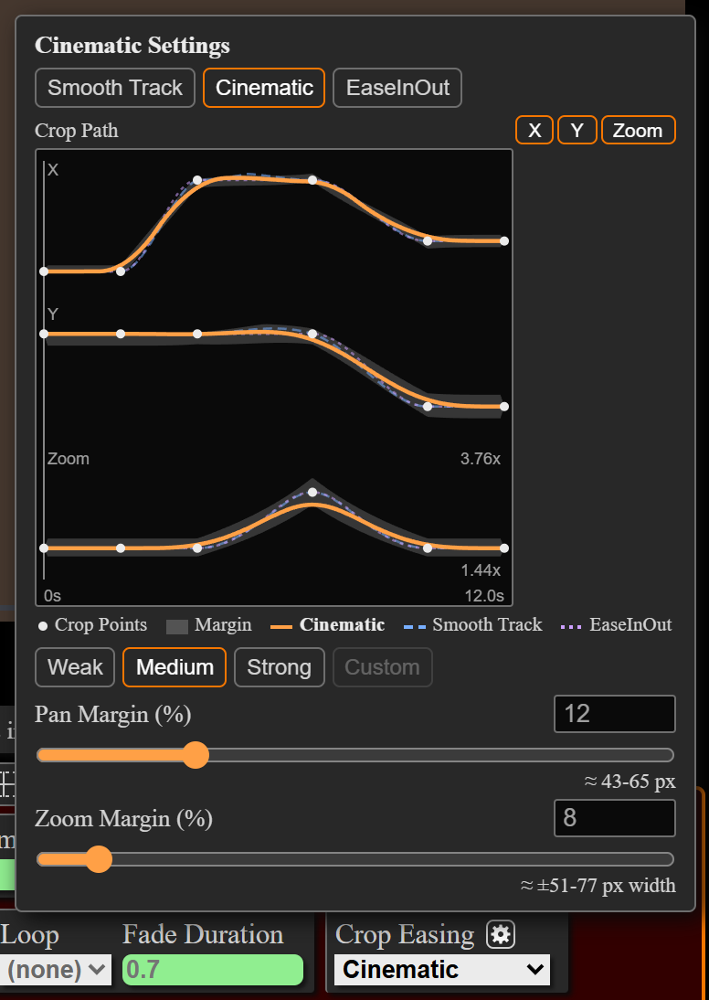
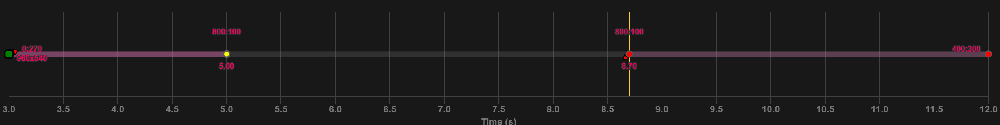

### Highlights

#### Crop Easing

Use the **Crop Easing** setting to choose how a dynamic crop pans and zooms between crop points. Find it in the global settings editor, and override it per marker pair in the marker pair editor.

* **Smooth Track (default):** The crop keeps moving through points without stopping at each one. Use it to follow a moving subject.
* **Cinematic:** The crop follows the points within a margin, with steady pauses and constant-speed pans. Use it for camera-like motion.
  * Click the gear button next to **Crop Easing** to set the margins, or pick **Weak**, **Medium** or **Strong**.
  * In a marker pair's settings, a plot shows the Cinematic path next to the Smooth Track and EaseInOut paths.
* **EaseInOut:** The crop easing from before 5.49.0. The crop slows to a stop at every point. The `markup script` and the `clipper script` use EaseInOut for markers data saved before 5.49.0.
* See [this readme section](https://github.com/exwm/yt_clipper#crop-easing) for the full details.

#### Hold Points

A hold point shows the crop of the crop point before it, and follows when that point changes. Hold points have a vertical yellow bar behind them. A new marker pair ends in a hold point.

* **Ctrl+Shift+Click:** Toggle a crop point between hold and normal.
* **Ctrl+Alt+A:** Add a hold point at the current time, or toggle the crop point under the playhead.
* **Ctrl+Alt+Shift+Click:** Toggle crop point easing between auto and instant (moved from **Ctrl+Shift+Click**).
* With Cinematic crop easing, the crop slows down evenly into each hold and holds still there. Set **Hold Points** to **Firm** in the Crop Easing settings to stop within the **Pan Margin**.
* See [this readme section](https://github.com/exwm/yt_clipper#crop-chart-shortcuts) for the full details.

#### Update Checks and Shared Settings

* Run `yt_clipper_check_for_updates.bat` (Windows) or `yt_clipper_check_for_updates` (Mac), or pass `--check-for-updates`, to check for a newer `clipper script`.
* Put settings every version should use (for example `--cookies`) in `yt_clipper_default_args.txt` in the folder that holds your yt_clipper installs. An install's own `default_args.txt` overrides the shared file when both set the same option.
  * Keep your installs in a folder of their own, not in your downloads folder. A `yt_clipper_default_args.txt` saved next to them can set the folders the `clipper script` runs ffmpeg and yt-dlp from.
  * Put options new in 5.49, such as `--accept-lower-quality`, in the install's own `default_args.txt`. Older versions stop on an option they do not know.
* Click **Releases** at the bottom right of the command palette (**Shift+E**) to see what changed.
* See [this readme section](https://github.com/exwm/yt_clipper#updating) for the full details.
