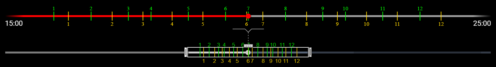

5.50.0 adds a timeline zoom for crowded markers and steadier video stabilization.

### Highlights

#### Timeline Zoom

Press **Shift+F**, or click its button (three dots over a two-way arrow) in the settings editor toolbar, to toggle the timeline zoom. Use it when marker pairs crowd together on long videos.

* A **zoomed bar** above the progress bar magnifies the zoom range, so nearby pairs spread out.
* On the progress bar, the **brush** frames the zoom range and shades the rest. **Drag** its edge handles to resize the zoom range, and its center handle to move it.
* On the zoomed bar, marker pairs work as on the progress bar. **Click** a marker number to open its pair, and **Alt+Drag** a number to move its marker. **Scroll** to zoom in or out, and **Shift+Scroll** to pan.
* During playback the zoom range follows the playhead.
* **Flatten VR Video** moved from **Shift+F** to **Shift+T**.
* See [this readme section](https://github.com/exwm/yt_clipper#marker-navigation-shortcuts) for the full details.

#### Video Stabilization

* Presets weaker than **Strongest** crop more and steady more than in 5.49.0.
* The motion analysis follows the camera instead of things that move on their own, and repairs the motion at flashes. Turn it off with `--no-video-stabilization-motion-analysis` (`-nvsma`) if a clip jolts or drifts.
* The `clipper script` warns when a stabilized clip comes out shakier than its input.
* The unstabilized clip is saved only with `--video-stabilization-save-shaky-clip`.
* For jumps between crop points, use **Cinematic** crop easing instead.
* See [this readme section](https://github.com/exwm/yt_clipper#video-stabilization) for the full details.
